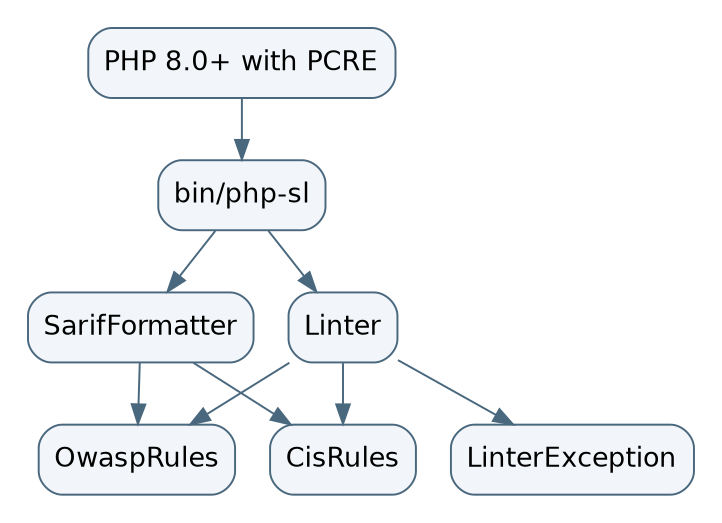

# PHP Security Linter (Beta)

A PHP tool to lint PHP files for security issues based on CIS and OWASP best practices.

[](https://packagist.org/packages/yousha/php-security-linter) [](https://github.com/Yousha/php-security-linter/actions/workflows/dependabot/dependabot-updates) [](https://php.net/) [](https://github.com/yousha/php-security-linter/issues)  [](LICENSE) [](CONTRIBUTING.txt)

## Contents

* [Overview](#overview)
* [Features](#features)
* [Requirements](#requirements)
* [Installation](#installation)
* [Configuration](#configuration)
* [Usage](#usage)
* [FAQ](#faq)
* [Support](#support)
* [Changelog](#changelog)
* [ToDo](#todo)
* [Contributing](#contributing)
* [Code of Conduct](#code-of-conduct)
* [DCO](#dco)
* [Contributors](#contributors)
* [Notice](#notice)
* [License](#license)

## Overview

This branch checks PHP 7.4 code and inline HTML templates for potential security issues. It parses PHP expressions to distinguish calls, arguments, and assignments from comments and strings. HTML checks inspect form controls and script sources in the template.

## Features

* **22 built-in checks** across the CIS-oriented and OWASP-oriented rule catalogs.
* Checks for directly observable input use, sensitive output, unsafe configuration, cookie-supplied session IDs, and literal credentials.
* Template checks for static POST forms and versioned jQuery or Bootstrap script references.
* **Fast static analysis** without executing code
* **Text reports** with file paths and line numbers
* **DevSecOps ready** CI/CD pipeline integration
* **Exclusion support** for ignoring specific paths
* **Supported PHP on this branch:** 7.4.x
* **Supported platforms:** Windows, GNU/Linux, MacOS

## Requirements

1. PHP 7.4.x with PCRE, DOM, and tokenizer
2. Composer >= 2

### Versions

| Package version | Branch        | PHP version | Status         |
|-----------------|---------------|-------------|----------------|
| dev-main        | `main`        | 8.*         | Active         |
| 3.*             | `main`        | 8.*         | Active         |
| 2.*             | `main-php7.4` | 7.4         | Maintenance    |
| 1.*             |               | 5.6         | EOL            |

* **Active**: Full support
* **Maintenance**: Critical/Security fixes only
* **EOL**: Unsupported

## Screenshots


## Diagrams

* Component diagram:



* Dataflow diagram:


## Installation

Via [Composer](https://getcomposer.org/):

```shell
composer require --dev yousha/php-security-linter
```

Or Composer global installation:

```shell
composer global require yousha/php-security-linter
```

## Configuration

Use the built-in checks with path exclusions. The PHP checks follow direct expressions, including concatenation and interpolation. They do not trace variables across assignments or infer effective application middleware. The session check reports request-supplied session IDs. The rate-limit check reports explicit removal of throttle middleware from a route.

A POST form finding means no recognized hidden CSRF field was visible in its static markup. PHP-generated forms with unknown content are skipped. Script version checks use literal JavaScript asset paths. A finding identifies a reference for review, rather than verifying deployed asset contents.

The rule catalogs expose an ID, severity, and message for each detector. The two injection rules have distinct IDs, OWASP-A1-SQL and OWASP-A1-CMD. PHP parse errors produce an incomplete-scan warning; other files are still scanned.

## Usage

Lint a directory:

```shell
php vendor/bin/php-sl --path=./src
```

Lint with exclusions:

```shell
php vendor/bin/php-sl --path=./app --exclude=vendor,tests
```

A scan accepts one directory. It skips excluded subtrees, special files, directory symlinks, and file symlinks leading outside the scan root. Relative exclusions match complete path components within the root. Absolute exclusions match the named path and its descendants.

Reports go to stdout. Warnings and argument errors go to stderr. An incomplete scan preserves findings from files it could check. The scanned-file count includes successfully read PHP files.

| Exit code | Meaning |
|---|---|
| 0 | Clean scan or help |
| 1 | Findings |
| 2 | Invalid arguments or scan target |
| 3 | Fatal error |
| 4 | Incomplete scan (read, traversal, or rule evaluation warning), including when findings are present |

### Command options

| Option       | Description                      |
| ------------ | -------------------------------- |
| `-p, --path` | Path to scan (required)          |
| `--exclude`  | Comma-separated paths to exclude |
| `--help`     | Show help message                |

### Example console output

```shell
Scan Results
========================================

File: /src/auth.php
  ✗ [CRITICAL] OWASP: SQL Injection vulnerability detected (Line 42)
  ✗ [HIGH] CIS: Hardcoded database credentials (Line 15)

File: /src/utils.php
  ✗ [MEDIUM] OWASP: XSS vulnerability possible (Line 88)

Summary: Scanned 24 files, found 3 potential issues.
```

### QA test

Run tests to ensure everything works as expected:

```shell
composer test
```

Or:

```shell
vendor/bin/phpunit tests/
```

## FAQ

See [FAQ.txt](FAQ.txt) file.

## Support

For any question, issues and feature requests, [open an issue.](https://github.com/yousha/php-security-linter/issues).

## Changelog

See [CHANGELOG.txt](CHANGELOG.txt) file.

## ToDo

See [TODO.txt](TODO.txt) file.

## Contributing

Contributions are welcome! Please follow these steps:

1. Fork repository.
2. Create a new branch for your feature or bugfix.
3. Submit a pull request with a detailed description of your changes.

For more details see [CONTRIBUTING.txt](CONTRIBUTING.txt).

## Code of Conduct

See [CODE_OF_CONDUCT.txt](CODE_OF_CONDUCT.txt) file.

## DCO

See [DCO.txt](DCO.txt) file.

## Contributors

See [CONTRIBUTORS.txt](CONTRIBUTORS.txt) file.

## Notice

See [NOTICE.txt](NOTICE.txt) file.

## License

This open-source software is distributed under the GPL-3.0 license. See [LICENSE](LICENSE) file.
